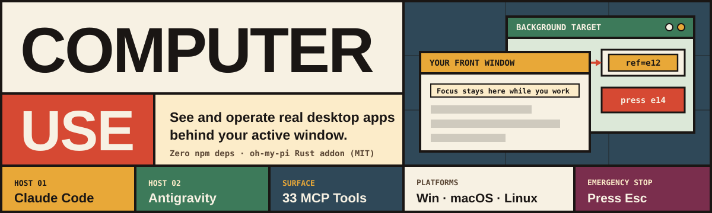
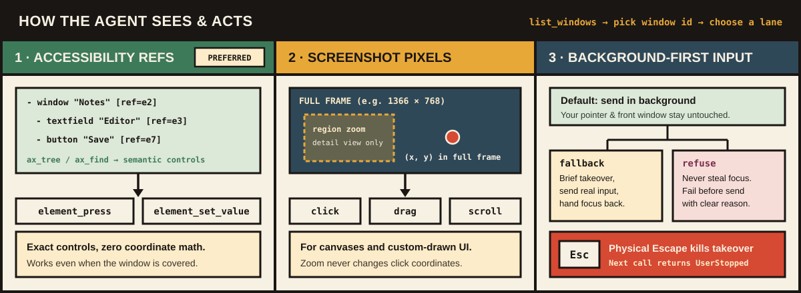
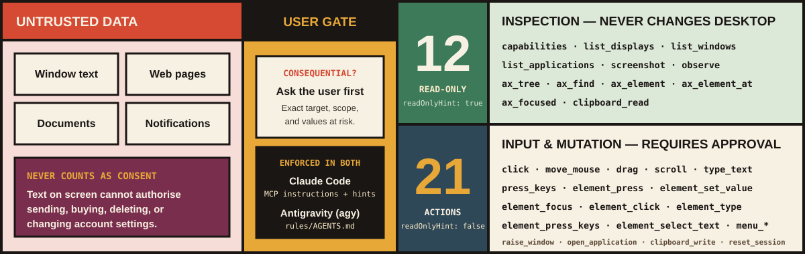

<p align="center">
  
</p>

<p align="center">
  <a href="https://github.com/zznabil/claude-computer/actions/workflows/ci.yml"></a>
  <a href="https://github.com/zznabil/claude-computer/releases/latest"></a>
  <a href="LICENSE"></a>
</p>

Desktop computer use for **Claude Code** and **Antigravity (`agy`)**. One dependency-free Node.js MCP server backed by [oh-my-pi](https://github.com/can1357/oh-my-pi)'s prebuilt Rust desktop addon — lists windows, takes screenshots, reads OS accessibility trees, sends background-first input, and accesses the clipboard on Windows, macOS and Linux.

## Quick start

**Claude Code** (v2.1.271+, Node.js 18+):

```sh
claude plugin marketplace add zznabil/claude-computer
claude plugin install computer@claude-computer
```

**Antigravity CLI (`agy` 1.5.17+)** — same folder, native plugin, no conversion:

```sh
agy plugin install https://github.com/zznabil/claude-computer
```

Pin a release with `agy plugin install https://github.com/zznabil/claude-computer/tree/v0.2.0`. agy also installs a local folder (a clone, or the extracted release zip): `agy plugin install ./claude-computer`. It does not install a `.zip` file directly.

On first use the server downloads `@oh-my-pi/pi-natives-<platform>-<arch>@19.2.1` (exact pin, `--ignore-scripts`, ~130–300 MB unpacked) into the host's plugin data folder. Then just ask:

- *"List my open windows."*
- *"Take a screenshot of the Notepad window and tell me what it says."*
- *"In the Settings window, turn on Dark mode."*

## How it works

<p align="center">
  
</p>

## Safety boundary

<p align="center">
  
</p>

> [!WARNING]
> Screen content (window text, web pages, documents, notifications) is **untrusted data** and never authorises an action. The agent must confirm with you before sending, buying, deleting, or changing settings. Use a separate account or VM for risky work.

---

<details>
<summary><strong>All 33 tools &amp; coordinate rules</strong></summary>

| Kind | Tools |
| --- | --- |
| Inspect (12 read-only) | `capabilities`, `list_displays`, `list_windows` (`wait` polls up to 10 s for a window that is still opening), `list_applications`, `screenshot` (with `region` = zoom), `observe` (screenshot + tree), `ax_tree`, `ax_find`, `ax_element`, `ax_element_at`, `ax_focused`, `clipboard_read` |
| Act on elements (7) | `element_press` (default press, any named AX action, optional `menu` path), `element_set_value`, `element_focus`, `element_click`, `element_type`, `element_press_keys`, `element_select_text` |
| Native input (8) | `click`, `move_mouse`, `drag`, `scroll`, `type_text`, `press_keys`, `hold_keys` (keys held 0–100 s, then released), `hold_mouse` (button held 0–100 s, then released) |
| Other actions (6) | `menu_items` *(not read-only: makes window key on macOS)*, `menu_select`, `raise_window`, `open_application`, `clipboard_write`, `reset_session` |

- **Targets**: a window `id` from `list_windows`, `"desktop"`, or `"display:<id>"`, `"display:active"`, `"display:all"`.
- **Coordinates**: pointer `x,y` are pixels in the **latest full screenshot of the same target**. Zoom (`region`) never changes that frame. AX bounds and `ax_element_at` use global desktop coordinates. Do not mix the two.

</details>

<details>
<summary><strong>Approvals &amp; read-only allow-lists (Claude Code &amp; Antigravity)</strong></summary>

Every tool carries MCP annotations: **12** inspection tools set `readOnlyHint: true`, **19** other tools set `readOnlyHint: false` (input/mutation tools also set `destructiveHint: true`).

**Claude Code** — In **plan mode**, read-only tools run without prompting (tested with Claude Code 2.1.332). To auto-allow the 12 inspection tools in default mode while keeping prompts for input, add to `~/.claude/settings.json` or `.claude/settings.json`:

```json
{
  "permissions": {
    "allow": [
      "mcp__plugin_computer_computer__capabilities",
      "mcp__plugin_computer_computer__list_displays",
      "mcp__plugin_computer_computer__list_windows",
      "mcp__plugin_computer_computer__list_applications",
      "mcp__plugin_computer_computer__screenshot",
      "mcp__plugin_computer_computer__observe",
      "mcp__plugin_computer_computer__ax_tree",
      "mcp__plugin_computer_computer__ax_find",
      "mcp__plugin_computer_computer__ax_element",
      "mcp__plugin_computer_computer__ax_element_at",
      "mcp__plugin_computer_computer__ax_focused",
      "mcp__plugin_computer_computer__clipboard_read"
    ]
  }
}
```

**Antigravity (`agy`)** — `agy` ignores `readOnlyHint` and names the server `computer_computer`. Add to `~/.gemini/antigravity-cli/settings.json` (or pass via `agy --settings '<json>'`):

```json
{
  "permissions": {
    "allow": [
      "mcp(computer_computer/capabilities)",
      "mcp(computer_computer/list_displays)",
      "mcp(computer_computer/list_windows)",
      "mcp(computer_computer/list_applications)",
      "mcp(computer_computer/screenshot)",
      "mcp(computer_computer/observe)",
      "mcp(computer_computer/ax_tree)",
      "mcp(computer_computer/ax_find)",
      "mcp(computer_computer/ax_element)",
      "mcp(computer_computer/ax_element_at)",
      "mcp(computer_computer/ax_focused)",
      "mcp(computer_computer/clipboard_read)"
    ]
  }
}
```

Leave out `clipboard_read` and `screenshot` if you want a prompt before reading potentially private data. Do not use `--dangerously-skip-permissions` for real work.

</details>

<details>
<summary><strong>Configuration, settings.json, updates &amp; environment overrides</strong></summary>

- **Claude Code**: run `/plugin configure computer@claude-computer` or `/config`. To update: `claude plugin marketplace update claude-computer`, then `claude plugin update computer@claude-computer`, then restart Claude Code. Try a local clone for one session with `claude --plugin-dir /path/to/claude-computer`.
- **Antigravity (`agy`)**: put `settings.json` in `PLUGIN_DATA` (e.g. `~/.gemini/antigravity-cli/plugin_data/computer/settings.json`), which survives updates:

```json
{ "takeover": "refuse", "max_width": 1366, "max_height": 768 }
```

To update in `agy`, close running `agy` sessions first on Windows (so the open server doesn't block renaming the folder), then re-run `agy plugin install`. Remove with `agy plugin uninstall computer`.

| Setting | Default | Effect |
| --- | --- | --- |
| `takeover` | `fallback` | `fallback`: briefly takes over when an app rejects background input, then hands focus back. `refuse`: never steals focus; refuses `takeover: true`, desktop/display input, `raise_window`, raise AX actions, `open_application` with `activate`/`reveal`, off-macOS `element_focus`, and (macOS) menu-opening calls. |
| `max_width` / `max_height` | `1366` / `768` | Maximum screenshot dimensions sent to the agent; input coordinates follow the delivered image. |
| `call_timeout_ms` | `120000` | Env: `COMPUTER_CALL_TIMEOUT_MS`. Cancels calls past deadline (`Timeout`). |
| `install_timeout_ms` | `600000` | Env: `COMPUTER_INSTALL_TIMEOUT_MS`. Kills hung first-run `npm install`. |

**Precedence**: environment variable (`COMPUTER_*`) → `settings.json` in plugin data dir (`CLAUDE_PLUGIN_DATA`, `PLUGIN_DATA`, or `~/.cache/claude-computer`) → default. Call `capabilities` to inspect the active host, data folder, settings, and sources.

</details>

<details>
<summary><strong>Platform limits, OS permissions &amp; Windows foreground lock</strong></summary>

- **Windows**: XAML/WinUI hosts (e.g. modern Notepad) ignore background keystrokes; `fallback` takes over briefly, `refuse` fails. Takeover is subject to Windows' foreground lock (`ForegroundLockTimeout`) and requires a foreground window to hand focus back to; AX routes (`element_set_value`, `element_press`, `menu_select`) work in the background regardless. Elevated/UAC/locked screens block input. `list_windows` returns `[]` when no top-level window is open and prefers exact app names over substrings.
- **macOS**: grant **Screen Recording** and **Accessibility** to the terminal/IDE running Claude Code or `agy`, then restart it. `element_select_text`, `open_application` with `app`/`reveal`, and window return on open are macOS-only.
- **Linux**: X11 requires RandR/XTEST and AT-SPI. Wayland lacks per-window background input and `raise_window`, needs the ScreenCast portal + `libpipewire-0.3`, and requests RemoteDesktop permission. Only Windows was tested live for this release; macOS and Linux use the same addon and pass CI unit tests.
- **Session &amp; scope**: one tool call runs at a time; element refs and screenshot frames live per server process (`reset_session` or restart drops them); graceful close runs on host disconnect / `SIGINT` / `SIGTERM`.
- **Intentionally omitted from omp**: task-scoped `control.acquire`, the `computer.run` JS runner, omp-decided `foreground`/`always` takeover modes, the `computer.display` setting (pick a `display:<id>` target per call instead) and macOS `bringToCurrentSpace`.

</details>

<details>
<summary><strong>Architecture, credits (oh-my-pi) &amp; local development</strong></summary>

- **Why reuse the omp addon**: omp's desktop backend is a large Rust codebase (Win32/macOS/X11/Wayland capture, input, UIA/AX/AT-SPI) shipped prebuilt for 6 platforms under MIT (`@oh-my-pi/pi-natives` 19.2.1). `server/native.mjs` loads the `.node` binary directly in plain Node.js without Bun, while `server/mcp.mjs` answers `initialize` immediately even during first-run download.
- **Credits**: Native backend, tool design, input policy, and safety guidance from [oh-my-pi](https://github.com/can1357/oh-my-pi) by Can Bölük, Mario Zechner and Stencil Labs, Inc. (MIT — see [NOTICE](NOTICE)). omp's computer use began in commit [`b9504f65e7`](https://github.com/can1357/oh-my-pi/commit/b9504f65e7bc471bd79ee218f7fb2d6c74ab44e2) ("feat: add native Codex computer use", 2026-07-23) and became a general tool in `681d7daf65` (2026-07-24).
- **License**: MIT — see [LICENSE](LICENSE).
- **Updating the addon**: the pin is exact and updated by hand. `node scripts/check-addon-drift.mjs` lists every place that names it and compares with npm; a weekly workflow opens an issue on drift. To bump: change all of those places to the new version, run `npm test` and `node test/live-hold.mjs`, then release.

```sh
npm install                    # optional: install platform addon into ./node_modules
npm test                       # protocol, annotation, config, refuse and timeout tests
claude plugin validate .
agy plugin validate . --strict
node test/live-notepad.mjs     # Windows: scratch Notepad round-trip
node test/live-agy.mjs         # Windows + agy: agy drives a scratch Notepad round-trip
node test/live-hold.mjs        # Windows: hold_keys, hold_mouse and list_windows wait on a scratch WinForms window (works while the screen is locked)
node scripts/check-addon-drift.mjs   # pinned addon vs npm latest (--offline: local pins only)
node scripts/make-icon.mjs     # regenerate assets/icon.png
```

</details>
